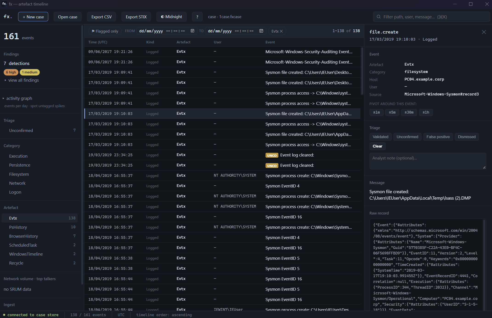
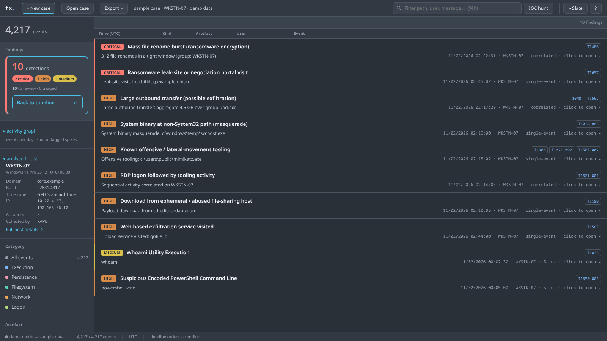
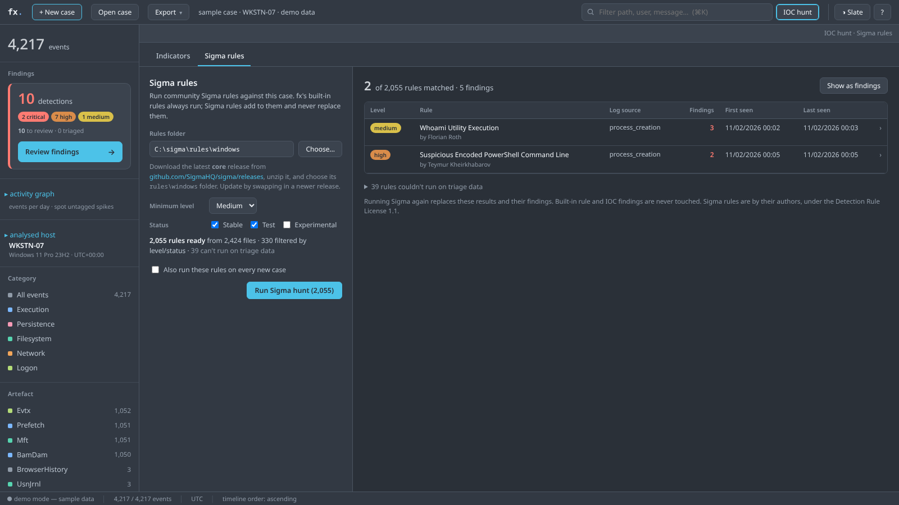
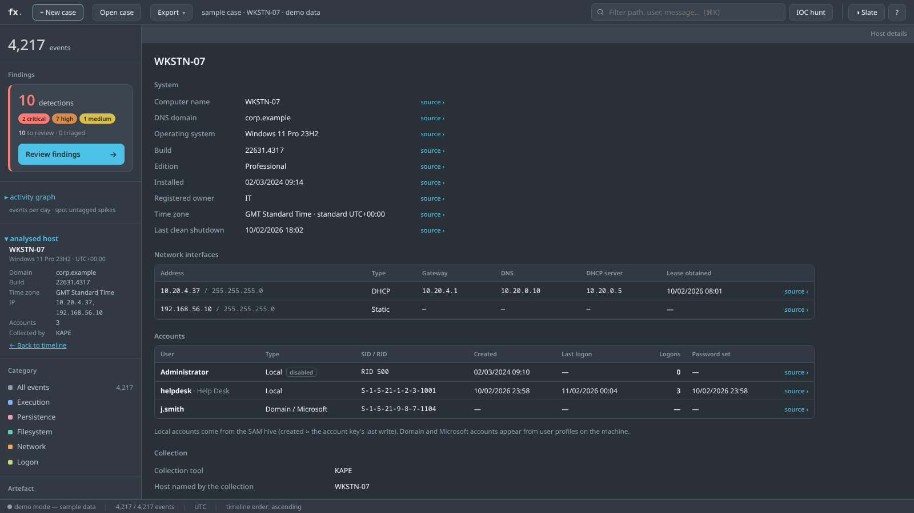
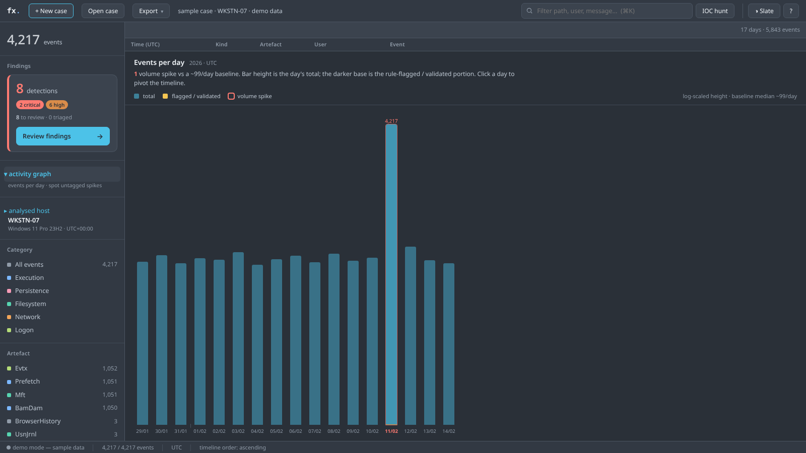
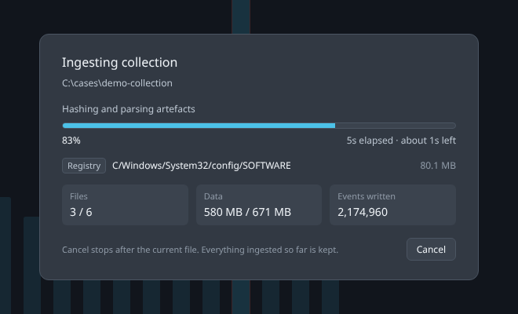

<h1 align="center">fx</h1>

<p align="center"><b>Windows artefact analysis &amp; threat hunting — local, offline, hunting-first.</b></p>

<p align="center"><i>Early developer preview · v0.1.6</i></p>

---

fx is a Rust, local-desktop forensic **triage and threat-hunting** tool for
Windows artefacts, oriented toward the TTPs of financially-motivated threat
actors — ransomware affiliates and e-crime intrusion sets. Think Axiom / EnCase
/ X-Ways in spirit, but **hunting-first**, **format-agnostic on input**, and
**fully offline**.

Point it at a folder of extracted Windows artefacts — from KAPE, Magnet
RESPONSE, Velociraptor, CyLR, or a raw copy — and fx:

1. **Identifies** every file by content (magic bytes), not by extension.
2. **Normalises** everything onto one timeline (`fx_core::Event`).
3. **Hunts** with 37 behaviour-based built-in rules (generic ATT&CK techniques
   + the top ransomware crews' TTPs), embedded in the binary — and, optionally,
   the ~2,000 community **SigmaHQ** Windows rules and your own **IOC lists**.
4. Lets you **triage, tag, pivot, visualise activity, and export** findings —
   with the SHA-256-hashed evidence behind every result.

### Where fx fits

fx is an **automated triage tool**, not a fully featured commercial forensic
suite. It complements the open-source tools DFIR teams already rely on — Eric
Zimmerman's tools, Chainsaw, Hayabusa, Autopsy and others — by putting the
whole collection on one timeline, running the hunt automatically, and handing
you a short, evidence-backed worklist to start from.

> ⚠️ fx is a **triage aid**. Findings are investigative **leads to corroborate**,
> not verdicts; **absence of findings is not proof a host is clean.**

---

## Get it

| | |
|---|---|
| **Run it** | Download `fx-gui.exe` (desktop) and/or `fx.exe` (CLI) from the [**Releases**](../../releases) page. Rules are embedded — nothing else needed. |
| **Build it** | See [**`INSTALL.md`**](INSTALL.md) — step by step from a bare machine. A normal clone builds with no dependency fiddling (`Cargo.lock` is committed; `nom` is pinned). |
| **Learn it** | [**`HELP.md`**](HELP.md) — every view and feature. · [**`RUNBOOK.md`**](RUNBOOK.md) — end-to-end operator workflow. · [**`ARCHITECTURE.md`**](ARCHITECTURE.md) — how it's built. |

> **Antivirus note:** fx is an unsigned binary carrying hunt rules that name
> offensive tools. Defender / EDR may quarantine it — expected for a DFIR tool.
> See [`INSTALL.md`](INSTALL.md).

---

## Before you start — what to download

**Running the prebuilt binary?** You need almost nothing:

- **`fx.exe`** (CLI) — nothing else.
- **`fx-gui.exe`** (desktop app) — also needs the **Edge WebView2 runtime**.
  Windows 10 / 11 already have it; **Windows Server usually doesn't** —
  [download it here](https://developer.microsoft.com/microsoft-edge/webview2/)
  (*Evergreen Standalone Installer*).

**Building from source?** Install these three first — they are one-time, per
machine, and the build will fail without them:

| # | Prerequisite | Why | Get it |
|---|--------------|-----|--------|
| 1 | **Rust toolchain** (1.81 or newer) | compiles fx | <https://rustup.rs> — run `rustup-init.exe`, accept defaults, then **open a new terminal** |
| 2 | **C/C++ build tools** | DuckDB & SQLite compile from source | **Windows:** [Build Tools for Visual Studio](https://visualstudio.microsoft.com/downloads/) → *Build Tools* → **"Desktop development with C++"** workload · **Linux:** `sudo apt install build-essential` · **macOS:** `xcode-select --install` |
| 3 | **Web view** (GUI only) | renders the desktop UI | **Windows / macOS:** the OS web view (install [WebView2](https://developer.microsoft.com/microsoft-edge/webview2/) on Windows Server) · **Linux:** `sudo apt install libwebkit2gtk-4.1-dev libgtk-3-dev` |

After installing Rust, confirm it's on your PATH in a **fresh** terminal:

```
rustc --version      # must be 1.81 or newer
cargo --version
```

> Only the one-time build needs the network (to fetch crates). **Analysis is
> fully offline** — no network, no telemetry.

Full step-by-step, including a troubleshooting table, is in
[**`INSTALL.md`**](INSTALL.md).

---

## Screenshots

*Captured from fx's built-in demo case (synthetic data, Slate theme).*

### Artefact timeline
Every artefact on one timeline. The narrow activity strip at the top filters by
time range with a click or drag; flagged events are marked inline; the detail
panel shows the full message, the raw record and one-click triage and pivots.



### Findings
Built-in rule detections, worst first, each ATT&CK-mapped and one click from the
underlying evidence.



### Sigma rules
Point fx at a SigmaHQ release and run ~2,000 community Windows rules on top of
the built-in pack. Results are grouped by rule, with the author credited.



### Analysed host
Computer name, OS, time zone, network interfaces and accounts read from the
registry — every value links back to the event it came from.



### Activity graph
Events per day across the whole case: spot volume spikes no rule flagged, then
click a day to pivot the timeline to it.



### Live progress
Ingest, detections and Sigma runs show what's happening and how long is left —
and can be cancelled without losing the work already done.

<p align="center"></p>

---

## Highlights

### Artefacts
- **Broad coverage** — EVTX, `$MFT`, registry hives, Prefetch, AmCache, SRUM,
  `$UsnJrnl`, scheduled tasks, browser history (Chromium / Edge / Firefox),
  LNK / jump-lists, PowerShell console history, Windows Timeline, Recycle Bin,
  USB / device, network-profile & autostart registry keys, Run-dialog (RunMRU),
  outbound-RDP history, and **remote-access tool logs** (AnyDesk, TeamViewer,
  ScreenConnect).
- **User activity** — recent documents, Open/Save dialog history, typed
  Explorer paths and searches, mapped drives and shares, typed URLs, Office
  recent files and **Office documents where macros were enabled**.
- **Memory remnants** — command lines, URLs, IPs, domains, hashes and tool
  names carved from `pagefile.sys` / `swapfile.sys` (the rules and IOC hunt
  run on them), plus `hiberfil.sys` state.
- **PCA and setupapi** — Windows 11 Program Compatibility Assistant launch
  records (execution evidence where Prefetch is off) and the first time each
  USB device was connected.
- **ShellBags with full folder paths** — shell items decoded properly (known
  folders, volumes, long file names, network shares), so you see
  `This PC\C:\Users\…\Finance` rather than raw bytes.
- **Microsoft Defender** — detections, remediation success/failure, ASR blocks,
  network protection and tampering (RTP / tamper protection disabled) from the
  event log, plus **MPLog** detections, process activity and file hashes that
  survive event-log clearing. Two built-in rules raise these as findings.
- **Host details** — computer name, domain, OS edition and build, time zone,
  last shutdown, network interfaces (IP, DHCP, DNS, gateway), local accounts
  with logon counts and last logon / password-set times, and user profiles —
  all from the registry. Shown as **analysed host** in the left rail, with a
  full host view that links every value back to its source event.

### Hunting
- **Built-in rule pack** — single-event and correlation rules, ATT&CK-mapped and
  embedded in the binary, including per-group rules for the top ransomware crews
  (Qilin, Akira, Play/DragonForce, LockBit, INC, Interlock, Clop…). Runs
  automatically on every new case with no setup. Each rule carries its own
  match / no-match self-tests.
- **Sigma rules** — point fx at a SigmaHQ release (`sigma_core+`, folder
  `rules\windows`) and run ~2,000 community Windows rules on demand, on top of
  the built-in pack, from the GUI or the CLI. Rules that can't apply to triage
  data are skipped and counted, never guessed at. Config and results are saved
  with the case.
- **IOC hunt** — paste, load or drop an indicator list (hashes, IPs, domains,
  URLs, paths, defanged or not) and hunt the whole case in one pass. The list
  and results are saved with the case; every match is clickable, triageable
  and exportable.

### Analyst workspace
- **Allow-list** — suppress known-benign findings (per case or for every case)
  without deleting them; review and restore them at any time. Noisy Sigma
  rules can be disabled per rule.
- **Artefact notes** — hover over any artefact in the rail for what that
  evidence source shows and why it matters.
- **Live progress** — while a case ingests or a hunt runs, a progress panel
  shows the phase, a size-weighted progress bar, the file being parsed, files
  and data done, events written, elapsed time and time left. Failed files and
  record warnings are summarised afterwards in the ingest log.
  **Cancel** keeps everything ingested so far.
- **Built for real case sizes** — a virtualised timeline stays responsive across
  **millions of events**; rules are compiled and gated so 2,000+ Sigma rules run
  over a multi-million-event case in minutes.
- **All events + mini timeline** — a narrow activity strip above the timeline;
  click or drag across it to filter to a time range. A per-day activity graph
  in the rail surfaces volume spikes no rule flagged.
- **Findings only** — one toggle narrows the timeline to events behind a
  detection or that you've triaged; **Clear all filters** resets everything.
- **Triage & tags** — mark events Validated / Unconfirmed / False positive /
  Dismissed with notes; right-click any event to tag it with your own tags and
  filter by tag from the rail.
- **Detail panel** — resizable, with the full message, a pretty-printed raw
  record (font size, wrap, copy) and pivot ±1m / 5m / 30m / 1h around any event.
- **Export** — CSV / STIX 2.1, plus a self-contained interactive **HTML / PDF
  case report** with a chain-of-custody evidence table.
- **Offline & provenance-first** — no network at analysis time; every event
  traces back to a hashed source file, a parser, and a record locator.

---

## What it's hunting (the adversary model)

fx targets the **modern ransomware / eCrime intrusion**, across the full kill
chain. The densest, highest-severity coverage is in the two phases that matter
most for these actors:

- **Credential Access** — LSASS dumping, mimikatz, NTDS.dit / DCSync, Veeam
  credential theft.
- **Impact** — shadow-copy deletion, BYOVD EDR-kill, safe-boot tricks,
  mass-encryption bursts, leak-site visits.

Rules are **YAML, loaded at runtime** (`crates/hunt/rules/`), so you extend
coverage without a rebuild. fx can also absorb external IOC packs
(`fx import-iocs`). A sample of the shipped signals:

| Rule | Engine | ATT&CK | Signal |
|------|--------|--------|--------|
| shadow_copy_deletion | single | T1490 | vssadmin / wbadmin / bcdedit backup destruction |
| system_binary_masquerade | single | T1036.005 | system-binary name at non-System32 path |
| offensive_tooling | single | T1003 / T1021.002 / T1567.002 | mimikatz / PsExec / Cobalt Strike / rclone |
| defender_tampering | single | T1562.001 | Defender disable / exclusions |
| mass_rename_ransomware | correlation | T1486 | N file renames in M seconds (USN) |
| srum_bulk_exfil | correlation | T1048 / T1567 | large outbound bytes per process (SRUM) |
| rdp_then_tooling | correlation | T1021.001 | RDP logon then tooling on same host |
| suspicious_scheduled_task | single | T1053.005 | task launching from staging dir / LOLBin |

For the full engine design, see [`ARCHITECTURE.md`](ARCHITECTURE.md).

---

## Quick start (CLI)

```bash
# Ingest an extracted collection into a new case file
fx ingest C:\evidence\host01_triage host01.fxcase --name "IR-2026-014" --examiner "A. Analyst"

# Summarise the case
fx summary host01.fxcase

# Hunt with the embedded rule pack (or point at your own)
fx hunt host01.fxcase
fx hunt host01.fxcase --rules C:\my\rules

# Add community Sigma rules (optional level / status filters)
fx hunt host01.fxcase --sigma C:\sigma\rules\windows --sigma-level medium --sigma-status stable,test

# Write a self-contained HTML case report (print to PDF to archive)
fx report host01.fxcase report.html
```

Or launch **`fx-gui`** for the analyst workspace: **New case** → pick the
collection folder and where to save the `.fxcase`, and fx ingests, hunts and
opens it for you. Run in a plain browser, the UI loads representative sample
data so you can explore it before loading real evidence.

---

## Scope

**In (today):** loose **extracted** artefact files (EVTX, `$MFT`, AmCache,
registry hives, `$UsnJrnl`, `$LogFile`, Prefetch, SRUM, tasks, LNK, browser
history…), in whatever layout the collection tool produced.

**Out (later phases):**

- **Legacy IE / old-Edge history** (`WebCacheV01.dat`, ESE) — modern
  Chromium / Edge / Firefox history already parses.
- **Disk-image input** — mounting E01 / VHDX / raw images.
- **Memory forensics** — live-process / loaded-module artefacts.

Broader parser coverage, full-text indexing, and richer reporting are ongoing.

---

## Licence

**Source-available.** Free for **any use, including paid IR / forensic
engagements** — you simply can't **resell fx itself** (as a product or hosted
service) without a commercial agreement. See [`LICENSE`](LICENSE). This is **not**
an OSI open-source licence.

---

<p align="center"><sub>fx is a triage and hunting aid. It supports analyst judgement; it does not replace it.</sub></p>
